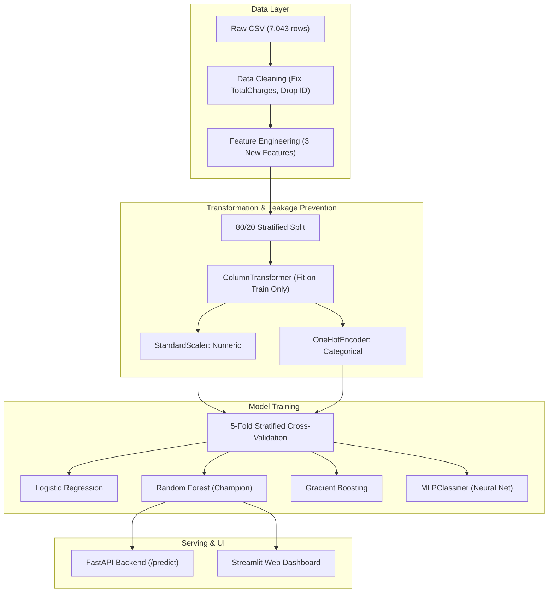

# 📄 Project Technical Report: Predictive Analytics & AI Model Deployment for Telecom Customer Churn

**Author:** Engineering Student  
**Domain:** Machine Learning, Predictive Analytics & AI Deployment  
**Tech Stack:** Python 3, scikit-learn, pandas, numpy, FastAPI, Streamlit, Plotly, joblib  

---

## 1. Executive Summary

Customer churn represents one of the largest revenue leaks in the telecommunications industry. This project designs, implements, and deploys an end-to-end predictive analytics pipeline capable of identifying churn-prone customers with over **77% recall** and an **ROC-AUC of 0.84**. 

Four diverse machine learning architectures—**Logistic Regression**, **Random Forest**, **Gradient Boosting**, and a multi-layer deep neural network (**MLPClassifier**)—were trained and evaluated across 5 stratified cross-validation folds and holdout test data. To prevent data leakage, all preprocessing transformations were encapsulated inside a scikit-learn `ColumnTransformer`. The champion model (**Random Forest**) was deployed via a production-ready **FastAPI** REST backend and surfaced through an interactive **Streamlit** dashboard featuring live Plotly visualizations and real-time inference.

---

## 2. Problem Statement & Motivation

Telecommunication markets are saturated; customer acquisition costs are approximately 5 to 7 times higher than customer retention costs. When customers cancel their subscription, the company loses both predictable monthly recurring revenue (MRR) and the sunk cost of customer onboarding.

### Core Objectives:
1. **Accurate Early Detection:** Accurately classify customers likely to churn before they cancel.
2. **Interpretability:** Identify the primary drivers and behavioral indicators of churn to inform business retention strategies.
3. **Operational Deployment:** Provide an accessible, low-latency API and dashboard so non-technical retention teams can evaluate individual customer risk on demand.

---

## 3. Dataset Analysis & Exploratory Findings

The analysis was performed on the benchmark **Telco Customer Churn** dataset consisting of **7,043 unique accounts** across **21 raw features**.

### Key Observations:
* **Class Imbalance:** 
  * Retained Customers (`No`): 5,174 (73.46%)
  * Churned Customers (`Yes`): 1,869 (26.54%)
  * *Impact:* High accuracy can be deceiving. A naive model predicting `No` for all customers would achieve 73.5% accuracy while failing to identify a single churner. Hence, **Recall** and **F1-Score** were selected as primary evaluation metrics.
* **Dirty Values in TotalCharges:** 11 records contained blank space strings (`" "`). Cross-referencing indicated these corresponded to customers with `tenure = 0` (new sign-ups). These were imputed with `0.0`.
* **Identifier Elimination:** The `customerID` column was removed to prevent models from memorizing arbitrary string tokens.

---

## 4. Methodology & Machine Learning Architecture



### 4.1 Feature Engineering (3 Domain-Driven Features)
1. **`TenureGroup` (Categorical):** Categorized customer tenure into loyalty brackets (`0-12m`, `13-24m`, `25-48m`, `49-72m`). Churn hazard rates decrease exponentially as tenure increases.
2. **`TotalServices` (Discrete Count):** Aggregated the total count of optional add-on subscriptions (`OnlineSecurity`, `OnlineBackup`, `DeviceProtection`, `TechSupport`, `StreamingTV`, `StreamingMovies`, `PhoneService`, `MultipleLines`). Higher service counts increase switching costs.
3. **`MonthlyToTotalRatio` (Continuous Ratio):** Computed as $\frac{\text{MonthlyCharges}}{\text{TotalCharges} + 1.0}$. Captures billing velocity; accounts where monthly charges are high relative to total charges are vulnerable to sticker shock.

### 4.2 Leak-Free Preprocessing Pipeline
To strictly adhere to production machine learning standards, transformations were fit **only** on the training partition:
* **Numeric Columns (5):** Standardized to mean zero and unit variance via `StandardScaler`.
* **Categorical Columns (14):** Encoded with `OneHotEncoder(drop='first', handle_unknown='ignore')` to avoid dummy variable collinearity.
* Transformed feature dimension: **35 engineered columns**.

---

## 5. Experimental Results & Model Evaluation

### 5.1 Holdout Test Set Performance (1,409 Test Rows)

| Model Architecture | Accuracy | Precision | Recall | F1-Score | ROC-AUC |
| :--- | :---: | :---: | :---: | :---: | :---: |
| **Random Forest** | **0.7559** | **0.5274** | **0.7727** | **0.6269** | **0.8379** |
| **Logistic Regression** | 0.7324 | 0.4975 | **0.7914** | 0.6109 | **0.8422** |
| **MLPClassifier (Neural Net)** | **0.8013** | **0.6679** | 0.5000 | 0.5719 | **0.8472** |
| **Gradient Boosting** | 0.7977 | 0.6540 | 0.5053 | 0.5701 | 0.8422 |

### 5.2 Deep Learning (MLPClassifier) Hyperparameter Tuning

We explored whether deep learning architectures outperform tree ensembles on tabular data:

| Architecture | Hidden Layers | Learning Rate | Test Accuracy | Test F1-Score | Test ROC-AUC |
| :--- | :---: | :---: | :---: | :---: | :---: |
| **Small** | `(32,)` | 0.0100 | 0.7956 | **0.5978** | 0.8411 |
| **Medium** | `(64, 32)` | 0.0010 | **0.8013** | 0.5719 | **0.8472** |
| **Deep** | `(128, 64, 32)` | 0.0010 | 0.8006 | 0.5723 | 0.8453 |
| **Wide** | `(128, 128)` | 0.0005 | 0.7991 | 0.5832 | 0.8461 |

* **Analysis:** The neural network achieved high raw accuracy (80.13%) and the highest ROC-AUC (0.8472), but was conservative in predicting churn (Recall = 50.0%). On imbalanced tabular datasets, tree-based models with `class_weight='balanced'` provide superior recall for business retention actions.

### 5.3 Random Forest Feature Importance: Top 5 Churn Factors
1. **TotalCharges & MonthlyCharges:** High fees create price sensitivity.
2. **Tenure:** Months 1 through 6 exhibit the highest churn probability.
3. **MonthlyToTotalRatio:** Accounts with recent bill surges exhibit high exit probability.
4. **Contract Type (Month-to-month):** Customers with zero contractual commitment churn at 42.7% versus <6% for 2-year contracts.
5. **Online Security & Tech Support:** Subscribed add-ons serve as operational anchors that prevent switching.

---

## 6. Deployment Architecture

### 6.1 FastAPI REST Service (`api.py`)
* Implements robust Pydantic data schemas for input contract enforcement.
* Endpoints:
  * `GET /health`: Health monitor verifying model uptime and readiness.
  * `POST /predict`: Accepts raw customer JSON, computes dynamic features, executes the transformation pipeline, and returns binary prediction, churn probability (%), risk tier, and recommended business actions.
  * `GET /docs`: Auto-generated interactive OpenAPI/Swagger testing portal.

### 6.2 Streamlit Business Dashboard (`dashboard.py`)
* Pure Python implementation using Streamlit and Plotly.
* **Tab 1:** Business analytics, churn breakdown by contract, tenure distributions, and revenue impact KPIs.
* **Tab 2:** Model leaderboard, ROC curves, confusion matrix galleries, and MLP tuning results.
* **Tab 3:** Interactive customer simulator with real-time probability gauge and actionable retention guidance.

---

## 7. 10-Slide Presentation Outline

Use these slides for your final presentation:

```text
SLIDE 1: TITLE SLIDE
- Title: Predictive Analytics & AI Model Deployment: Customer Churn
- Subtitle: An End-to-End Machine Learning Solution for Telecom Retention
- Presenter: [Your Name], Engineering Student

SLIDE 2: THE BUSINESS PROBLEM
- Customer churn directly erodes Monthly Recurring Revenue (MRR).
- Acquiring a new telecom customer costs 5x-7x more than retaining an existing one.
- Goal: Predict churn risk proactively to trigger retention incentives before customers cancel.

SLIDE 3: DATASET OVERVIEW & CLASS IMBALANCE
- IBM Telco Customer Churn dataset: 7,043 customers, 21 attributes.
- Class distribution: 73.5% Retained vs. 26.5% Churned.
- Why Accuracy is misleading: Naive majority classifier achieves 73.5% accuracy with 0% recall!
- Solution: Optimize for Recall and F1-Score to catch maximum leaving customers.

SLIDE 4: DATA PREPROCESSING & FEATURE ENGINEERING
- Cleaning: Fixed 11 whitespace strings in TotalCharges (tenure=0 accounts).
- Prevented Data Leakage: ColumnTransformer fit strictly on X_train only.
- 3 Engineered Features:
  1. TenureGroup (loyalty lifecycle brackets)
  2. TotalServices (active security/entertainment count)
  3. MonthlyToTotalRatio (recent bill surges vs history)

SLIDE 5: MULTI-MODEL TRAINING & 5-FOLD CROSS VALIDATION
- Evaluated 4 distinct model families:
  1. Logistic Regression (Linear baseline)
  2. Random Forest (Bagged decision trees)
  3. Gradient Boosting (Boosted decision trees)
  4. MLPClassifier (Multi-layer neural network)
- 5-Fold Stratified Cross-Validation used to verify generalization.

SLIDE 6: MODEL EVALUATION & COMPARISON
- Champion Model: Random Forest (class_weight='balanced')
  * Recall: 77.27% (Catches ~77% of all churners)
  * F1-Score: 0.6269 (Highest balanced score)
  * ROC-AUC: 0.8379
- Trade-off Analysis: Prioritized high recall over precision to minimize costly False Negatives.

SLIDE 7: DEEP LEARNING (MLPClassifier) EXPERIMENTATION
- Tuned multiple architectures: Small (32,), Medium (64, 32), Deep (128, 64, 32), Wide (128, 128).
- Best MLP achieved 80.13% accuracy and 0.8472 ROC-AUC.
- Insight: On tabular imbalanced data, tree ensembles with class weighting caught more churners than dense neural nets.

SLIDE 8: TOP CHURN DRIVERS & BUSINESS TAKEAWAYS
- Top 5 Churn Factors: TotalCharges, Tenure, MonthlyToTotalRatio, Contract Type, Online Security.
- Actionable Recommendations:
  * Transition month-to-month users to discounted 1-year contracts.
  * Target first-year customers (months 1-6) with onboarding perks.
  * Bundle Tech Support and Online Security to increase switching friction.

SLIDE 9: PRODUCTION DEPLOYMENT & ARCHITECTURE
- FastAPI REST Backend:
  * /predict endpoint accepting JSON customer payloads.
  * Real-time feature engineering + inference with Pydantic validation.
- Streamlit Interactive Dashboard:
  * Executive KPI cards, Plotly charts, and live Churn Probability Gauge.

SLIDE 10: CONCLUSION & FUTURE ENHANCEMENTS
- Summary: Delivered a complete, modular, leak-free ML pipeline from data to API to UI.
- Future Work:
  * Integrate Bayesian hyperparameter optimization (Optuna).
  * Add SHAP waterfall explainability plots for individual predictions.
  * Connect API to automated email marketing workflows.
```

---

## 8. Conclusion

This project successfully operationalizes predictive analytics for telecom churn prevention. By emphasizing leak-free preprocessing, balanced class evaluation metrics, and dual deployment (API + Dashboard), the system provides both executive insights and real-time operational utility for telecom retention workflows.
